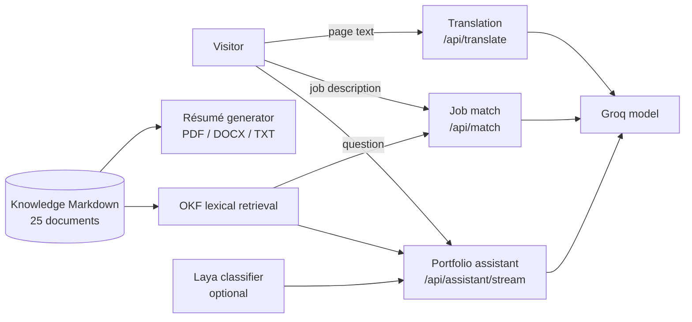

# AI system design review

Reviewed 12 November 2026 against a standard AI system design rubric: requirements, data, retrieval, models, agent control, guardrails, grounding, evaluation, observability, latency, reliability, cost, security and privacy, human oversight, scale, and change management. Each area cites the code that implements it and gives an honest rating.

**Ratings:** ✅ Meets — ◐ Partial — ✗ Gap

Detailed request flow and protocol: [ASSISTANT_ARCHITECTURE.md](ASSISTANT_ARCHITECTURE.md). Operational checks: [AGENTIC_ASSISTANT.md](AGENTIC_ASSISTANT.md).

## Summary

| # | Area | Rating | One-line verdict |
|---|------|:-:|---|
| 1 | Problem framing and scope | ✅ | Narrow, explicit domain; out-of-scope requests are refused before any model call. |
| 2 | Architecture and data flow | ✅ | Deterministic pipeline with one generation step; every stage is inspectable. |
| 3 | Knowledge and data layer | ✅ | Versioned Markdown with schema validation at startup; one source for chat, résumé, and job match. |
| 4 | Retrieval | ◐ | Measured recall@4 0.958, but lexical only: everyday paraphrases can still miss. |
| 5 | Model choice and prompting | ◐ | One pinned, configurable model; answer temperature 0.65 is high for factual answers. |
| 6 | Agent and tool control | ✅ | Rule-based planner, typed tools, four-call budget, double allowlist for UI actions. |
| 7 | Guardrails and prompt injection | ◐ | Layered input checks and delimited untrusted text; no output-side policy check. |
| 8 | Grounding and hallucination control | ◐ | Citations and grounding prompt; no automated faithfulness check on answers. |
| 9 | Evaluation | ◐ | Retrieval eval and behaviour tests gate CI; no answer-quality eval set yet. |
| 10 | Observability | ◐ | Request IDs, access logs, opt-in LangSmith traces, feedback events; no token or cost metrics. |
| 11 | Latency and UX | ✅ | Streaming tokens and progress events, timeouts, warm-up ping, stop/retry. |
| 12 | Reliability and fallbacks | ✅ | Every external dependency has a defined degraded mode. |
| 13 | Cost control | ✅ | Refusals skip the model, answer cache, bounded context and output, per-visitor rate limits. |
| 14 | Security and privacy | ✅ | Unguessable session IDs, erasure endpoint, retention purge, no personal data in analytics. |
| 15 | Human oversight | ✅ | Consequential actions are prepared, never executed; the visitor confirms. |
| 16 | Scale, deployment, and change management | ◐ | Fine for one instance; limits and memory fallback are per process. |

**Overall:** the design satisfies the core requirements for a production retrieval-grounded assistant: bounded agency, grounding with citations, layered guardrails, defined fallbacks, cost controls, and privacy by default. The open items are measurement gaps (answer-quality evaluation, token and cost telemetry) and two quality levers (semantic retrieval, lower answer temperature), all listed in [Recommended next steps](#recommended-next-steps).

## AI features in scope

| Feature | Model role | Untrusted input | Output contract | Degraded mode |
|---|---|---|---|---|
| Assistant | Streams a grounded answer after deterministic tools run | Visitor question and history | Plain text, sanitized; actions come from tools, not the model | Fixed refusal, or an error with retry |
| Job match | Classifies requirements as strong, partial, or gap | Pasted job description | JSON parsed against a schema; invalid output is discarded | Keyword evidence only |
| Translation | Translates UI strings in order | Page text | JSON array of the same length, validated | Original English text |
| Résumé | None (deterministic) | — | ATS-safe PDF, DOCX, TXT | Committed static copies |

## 1. Problem framing and scope — ✅

The assistant answers questions about one person's documented work and nothing else. Scope is enforced in three places: the local and Laya router (`app/ai/laya.py`), the system prompt (`app/ai/chain.py`), and the tool registry, which can only read portfolio content (`app/agent/tools.py`). Unrelated requests get a fixed localized reply without retrieval or generation.

Success criteria are implicit rather than written: correct facts, cited sources, safe actions. Area 9 turns the first of these into a measured number.

## 2. Architecture and data flow — ✅

`route → plan → execute → generate`, with the LLM used once, at the end (`app/agent/graph.py`). Routing and planning are deterministic, so the same question always takes the same path. That makes behaviour testable and easy to explain, and the public `/assistant-architecture` page shows exactly that flow. The trade-off is less flexibility than an LLM-planned agent loop. For a fixed domain with nine tools, that is the right call.

## 3. Knowledge and data layer — ✅

- Source of truth: `knowledge/` Markdown with YAML front matter, listed in `knowledge/index.md`, validated by `app/content.py` and `scripts/check_okf.mjs`. Startup fails fast on invalid documents (`main.py` lifespan).
- The same canonical objects feed chat, the résumé generator, job match, and the frontend snapshot (`portfolio.generated.js`), so facts cannot drift between surfaces.
- Changes go through git review, and `knowledge_version()` (a content hash) invalidates cached answers automatically when a document changes.

## 4. Retrieval — ◐

Implementation: token-overlap ranking with title and path weighting, topic hints, up to four sources, a 12,000-character context budget (`app/ai/okf.py`). A small query-expansion vocabulary maps everyday phrasing to résumé terms ("now" → "present").

Measured with `python -m evals.retrieval_eval` on 24 labelled questions:

| Metric | Before expansion | Now |
|---|:-:|:-:|
| Recall@4, all | 0.917 | **0.958** |
| Recall@4, direct questions | 1.000 | **1.000** |
| Recall@4, paraphrased questions | 0.714 | **0.857** |
| MRR | 0.781 | **0.833** |

`tests/test_retrieval_eval.py` fails CI if direct-question recall drops below 100% or overall recall below 0.9.

**Limit:** lexical search cannot connect concepts with no shared words. The remaining miss is "something like a dating app but for meeting other developers", which should retrieve Syncly. With 25 short documents, lexical search is fast, free, and transparent. Embeddings become worthwhile if paraphrase recall matters more, or the corpus grows past roughly 100 documents.

## 5. Model choice and prompting — ◐

- One model, `openai/gpt-oss-120b` on Groq, chosen for low-latency streaming. It is pinned in one place (`GROQ_MODEL` in `app/config.py`) for the assistant, job match, and translation.
- Per-task sampling: translation at 0, job match at 0.1 (classification), answers at `ANSWER_TEMPERATURE`, default 0.65.
- Bounded output: 400 tokens for answers, 1,400 for job match.
- Prompts state the role, the grounding rule, the refusal rule, the output format, and that retrieved text is never an instruction.

**Gap:** 0.65 favours a conversational tone over strict adherence to retrieved facts. For a factual assistant, 0.2–0.4 is the usual range. It is now configurable; lower it once an answer-quality eval (area 9) can confirm the tone stays acceptable.

## 6. Agent and tool control — ✅

- The planner is rule-based. The model never selects or executes tools.
- Nine tools, each with a Pydantic input schema; at most four calls per turn; a single pass with no self-directed loops.
- UI actions are restricted to known types and targets on the server (`app/agent/protocol.py`), and again on the client (`src/features/assistant/actions.js`). No generated URL, selector, or code ever runs.
- Only navigation and highlighting run automatically. Tours and contact drafts need a click, and restored conversations never replay actions.

## 7. Guardrails and prompt injection — ◐

| Layer | Control | Where |
|---|---|---|
| Input size | 500-character question, 64 KiB body, 8,000-character job description | `app/models.py`, `app/middleware.py`, `app/schemas/platform.py` |
| Input intent | Regex checks for prompt-extraction phrasing, then Laya classification | `app/ai/laya.py` |
| Indirect injection | Knowledge is owner-committed, so it is trusted. Job descriptions are wrapped in `<job>` tags and labelled as data. | `app/services/match.py` |
| Output format | Markdown stripped from answers; job-match JSON validated against a schema, with unknown statuses dropped | `app/ai/sanitizer.py`, `match._parse_assessment` |
| Output rendering | React escapes all model text, and no HTML is injected | frontend |
| Actions | Server and client allowlists (area 6) | — |

**Gaps:**
- The regex layer is easy to evade by rephrasing. Without a Laya key, unrelated questions are not classified at all; only the system prompt restrains the answer.
- There is no output-side check, for example that an answer contains no contact details absent from the knowledge base.
- Tokens are shown as they stream, before final sanitization. That is acceptable for formatting, and the clean text replaces the stream on `done`.

## 8. Grounding and hallucination control — ◐

- Answers may only use the context for the current turn. The prompt forbids inventing dates, metrics, employers, links, or contact details, and asks the model to say it is unsure instead.
- Every answer returns its sources as citations linking to public pages, so readers can verify claims.
- Job match grounds each requirement in named evidence and lists gaps explicitly, rather than implying a perfect fit.

**Gap:** grounding is enforced by the prompt, not checked. Nothing verifies that each claim in an answer appears in the retrieved context.

## 9. Evaluation — ◐

| Level | What exists | Runs in CI |
|---|---|:-:|
| Retrieval quality | 24-case recall and MRR eval with a regression gate | ✅ |
| Routing and planning | Unit tests for topics, prompt attacks, project follow-ups, tool selection | ✅ |
| Contracts | Schema limits, history budgets, SSE metadata, cache keys, action validation | ✅ |
| Job match | Keyword precision traps ("R&D" ≠ R, "go the extra mile" ≠ Go), parser rejects malformed output, fallback path | ✅ |
| UI behaviour | Browser suites with mocked providers: actions, receipts, stop/retry, saved chats | ✅ (frontend) |
| Online feedback | Thumbs up/down on answers, recorded as first-party events | — |
| **Answer quality** | **None**: no golden answers judged for correctness, faithfulness, or refusals | ✗ |

The missing piece is an answer-level eval: about 30 questions with expected facts and must-refuse cases, scored for faithfulness to the retrieved context. It needs live model calls, so it costs credits and belongs in a manual or nightly job rather than every CI run.

## 10. Observability — ◐

- An `X-Request-ID` header on every response, and a matching access-log line with method, path, status, and latency. Bodies, query strings, and IPs are not logged.
- `/api/health` reports database reachability, uptime, and version.
- LangSmith traces with named runs, opt-in via `LANGCHAIN_API_KEY`.
- Answer feedback and the conversion funnel (`/api/admin/funnel`).

**Gap:** no per-request token counts, model latency, cache hit rate, or refusal rate. These are the numbers that show cost drift or a quality regression after a prompt change.

## 11. Latency and UX — ✅

- Tokens stream as they arrive; progress events name what is being read, before generation starts.
- Timeouts: Laya 8 s, generation 30 s, job match 25 s, client 45 s. Stop and retry controls are in the UI.
- A health ping after page load wakes the free-tier server before the visitor asks anything, and the launcher shows the real connection status.
- Cached opening questions return without a model call.

## 12. Reliability and fallbacks — ✅

| Dependency fails | Behaviour |
|---|---|
| Laya | Local topic rules |
| Groq (assistant) | Readable error, with retry, for timeouts, capacity (413/429), or other failures |
| Groq (job match) | Keyword evidence only, labelled as such |
| PostgreSQL | Bounded in-process memory for sessions; cache falls back to process memory |
| GitHub or PyPI (proof) | Stale cache, then a 5-minute backoff and a link fallback |
| Backend asleep (résumé) | Committed static files from the same generator |

## 13. Cost control — ✅

- Refusals and cache hits never reach the model.
- Bounded history (8 items, 1,200 characters), context (12,000 characters), and output (400 tokens).
- Per-visitor rate limits: assistant 10/min and 100/day; job match 6/min and 40/day. Real client IPs are resolved behind the proxy with `TRUSTED_PROXY_COUNT`.
- The opening-question cache is shared through PostgreSQL. Its key ignores the session but includes the language and the knowledge hash.

## 14. Security and privacy — ✅

- Conversation IDs are `crypto.randomUUID()`. The earlier timestamp-based IDs were guessable (about 1,000 values per millisecond) and are re-keyed on load, with their server copies erased.
- `DELETE /api/assistant/session/{id}` backs Clear chat and Delete conversation. Unknown IDs also return 204, so the endpoint cannot be used to discover which sessions exist.
- Retention: sessions older than `SESSION_RETENTION_DAYS` (default 30) and expired cached answers are purged at startup.
- Analytics accept no personal fields (email, phone, name, message, content are rejected) and record path-only page views. Job descriptions are not stored.
- Secrets live only in server environment variables. Admin endpoints use a constant-time key comparison. CORS is an explicit allowlist.
- LangSmith tracing, when enabled, sends conversation content to a third party. It is off unless a key is set.

## 15. Human oversight — ✅

The system can propose but never commit. Contact actions prefill a draft that the visitor must send; tours start on a click; the job-match page hands off to a human conversation. Action receipts report what the browser actually did, not what the model claimed.

## 16. Scale, deployment, and change management — ◐

- A single container (`Dockerfile`, non-root user) on Render, with stateless request handling apart from optional PostgreSQL.
- **Per-process state:** the rate limiter, the in-memory answer cache, and the session fallback are local to each worker. Running more than one worker multiplies the effective limits and splits fallback memory. Use Redis storage for SlowAPI before scaling out.
- **Change management:** tool, limit, or model changes must update this document, [ASSISTANT_ARCHITECTURE.md](ASSISTANT_ARCHITECTURE.md), and the frontend `src/data/assistantArchitecture.js`. Knowledge changes invalidate the cache automatically. Retrieval changes are gated by the eval test.

## Recommended next steps

In order of value for effort:

1. **Answer-quality eval (area 9).** About 30 golden questions with expected facts and must-refuse cases. Score faithfulness with an LLM judge against the retrieved context and run it nightly or before releases. This unlocks item 2 safely.
2. **Lower `ANSWER_TEMPERATURE` to 0.3 (area 5)** once the eval confirms tone and accuracy hold.
3. **Token and latency metrics (area 10).** Log `usage_metadata` per call with the request ID; track cache hit and refusal rates.
4. **Semantic retrieval (area 4)** if paraphrase recall needs to pass 0.95: add embeddings alongside lexical scores (hybrid), keeping the eval as the gate.
5. **Output policy check (area 7).** Reject answers containing URLs, emails, or phone numbers absent from the retrieved context.
6. **Redis-backed rate limits (area 16)** before running more than one worker.
