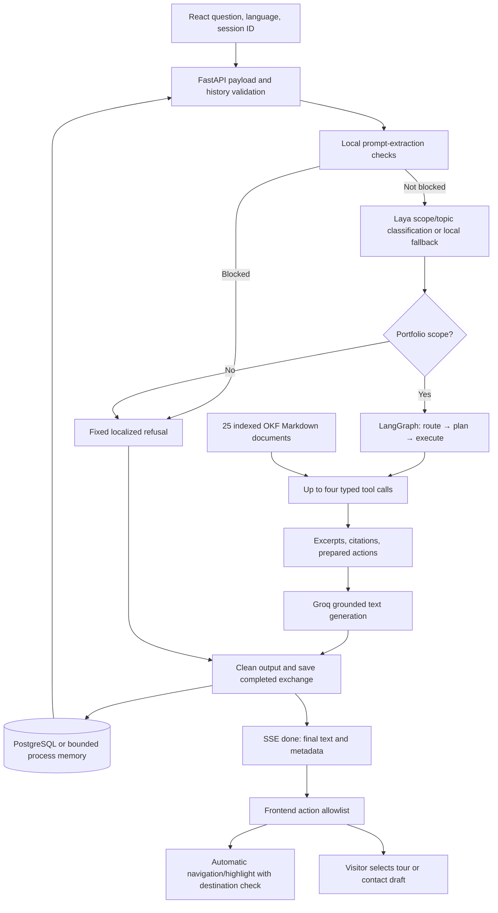

# Portfolio assistant architecture

Implementation review: 19 October 2026. Public interactive explanation: frontend `/assistant-architecture`. Operational setup and checks: [AGENTIC_ASSISTANT.md](AGENTIC_ASSISTANT.md). Full frontend/backend module map: `CODEBASE.md` in the companion frontend repository.

## Actual execution order



Laya is called by `stream_agent_turn` before the graph starts. The graph's `route` node consumes its decision. The planner uses deterministic rules and a fixed tool registry; the generation model does not choose or execute tools. The graph is a single pass with a maximum of four calls, not a self-directed retry loop.

`POST /api/assistant` uses the same agent preparation and returns one JSON response. `POST /api/assistant/stream` exposes progress and token events. The current routes use `app/agent/graph.py`; `app/ai/orchestrator.py` retains an earlier retrieval helper.

## Knowledge and grounding

`knowledge/index.md` lists 25 YAML-frontmatter Markdown documents: profile, education, certifications, skills, research interests/publications, ten independent projects, and four experience records. AIORA is described in the Ceiyone experience document. `app/content.py` validates paths and types, compiles canonical portfolio objects, and caches loaded documents.

`app/ai/okf.py` ranks sources by token overlap, weighting title/path/type matches more heavily than body matches. It returns up to four sources by default with a 12,000-character context budget per retrieval. There are no embeddings, vector database, web search, or live project inspection in this assistant. Source links map to public portfolio pages.

Tools can also read structured skills and résumé data directly. Groq receives the question, bounded history, selected language, and collected tool context. Its `openai/gpt-oss-120b` answer model is configured with temperature 0.65 and 400 maximum output tokens. Grounding is a prompt requirement, not a factual correctness guarantee.

## Typed tool surface

Read tools:

- `search_portfolio`: ranked Markdown context and citations.
- `get_project_details`: project implementation/contribution context and an optional highlight offer.
- `get_skills`: all or one matching structured skill category.
- `get_experience`: ranked career evidence.
- `get_resume`: selected canonical résumé sections.

Action preparation tools:

- `navigate_to_section`: allowlisted automatic navigation request.
- `highlight_element`: allowlisted automatic highlight request.
- `start_project_walkthrough`: visitor-started four-step case-study tour.
- `prepare_contact_action`: confirmation-marked draft handoff, without submission.

Arguments are validated with Pydantic before execution. `UiAction` restricts action types and targets; the frontend independently maps those targets to fixed routes/selectors. Only navigation/highlight are eligible for automatic execution, and only when confirmation is not required. Browser receipts follow destination lookup. Saved conversations set `runActions: false`, preventing replay after reload.

## Streaming protocol

The transport is a streaming POST read with `fetch`, not an `EventSource` GET. Each event is JSON prefixed with `data: ` and followed by a blank line.

```text
data: {"type":"status","phase":"reading","message":"Reading PocketPet implementation, contribution, and limitations"}

data: {"type":"tool","name":"get_project_details","status":"completed","summary":"Read PocketPet implementation, contribution, and limitations"}

data: {"type":"ui_action","action":{"type":"navigate","target":"projects.pocketpet","label":"Open PocketPet case study","auto_execute":true,"requires_confirmation":false,"data":{}}}

data: {"type":"token","text":"PocketPet pauses before sensitive actions."}

data: {"type":"done","done":true,"full":"PocketPet pauses before sensitive actions.","sources":[],"followups":[],"project":"pocketpet","actions":[],"tools":[],"session_id":"example-session"}
```

These examples illustrate event shapes, not one complete execution. `status` and `tool` events are emitted as graph work runs. `ui_action` events describe prepared actions after graph completion. After generation, final text is sanitized and persisted before `done`; the UI uses final metadata to render suggestions and execute permitted actions. Error events carry an `error` string. An incomplete stream is treated as failure by the client.

The frontend renders human-readable summaries rather than raw tool names. A completed trace is not proof that a browser action succeeded; the separate action receipt reports the browser result. Contact handoff only prefills a form, and the visitor must select Send Message.

## Routing, refusal, and fallback

Local regex checks run first for prompt extraction/override patterns. Laya, when configured, classifies `portfolio`, `unrelated`, or `prompt_attack` scope plus a portfolio topic. Rejected scopes schedule no tools and skip Groq; localized fixed text is saved and returned with empty actions/recommendations.

Without a Laya key or after handled HTTP/parsing failures, local topic keywords are used. This fallback does not independently identify every unrelated request. Both local detection and model classification have limits, and the generation prompt continues to restrict answers to portfolio facts.

Named project follow-ups can inherit a project from recent user messages. Suggested questions are curated English templates selected by project/topic and question aspect, with exact previously asked strings filtered; they are not generated by a second LLM call. The frontend's translation layer can translate displayed suggestions.

## Memory and budgets

The browser stores up to 12 conversation transcripts in localStorage. The request supplies a session ID. Server history takes precedence when available and is capped to eight items within 1,200 characters before generation. The memory layer independently keeps at most 20 cleaned messages per session, with 2,000 characters per stored message.

PostgreSQL stores sessions when configured. asyncpg JSONB values are decoded before use. Storage errors or unavailable storage use a bounded 256-session process cache. That cache is neither durable nor shared across workers. Session IDs partition data but are not account authentication.

The response cache holds up to 256 results and is used only for requests without history or a session ID. Browser Clear chat does not delete or rotate the server session; local transcript deletion is not server-side erasure.

Other bounds: 500 characters per question, 64 KiB request body, four tools per graph turn, 10 assistant requests/minute and 100/day per IP. Laya's default timeout is 8 seconds; answer generation has a 30-second timeout. The client uses a 45-second request timeout and one automatic retry. Client usage display is separate from server rate limits.

## Configuration and deployment

`app/config.py` loads the `.env` in the parent workspace. Inject secrets through the deployment environment in containers. `GROQ_API_KEY` is required; `LAYA_API_KEY`, `LAYA_BASE_URL`, `LAYA_TIMEOUT_SECONDS`, `DATABASE_URL`, `ADMIN_API_KEY`, `FRONTEND_ORIGIN`, `METADATA_CACHE_SECONDS`, and LangSmith variables configure optional services.

LangSmith tracing is enabled when its API key is supplied unless `LANGCHAIN_TRACING_V2=false`; trace data can include user content and session metadata. Keys are not included in frontend code or knowledge. Logging and provider policies should be reviewed separately rather than assuming all requests remain local.

The Dockerfile uses Python 3.11 and runs Uvicorn on port 8000 as a non-root user. `.dockerignore` includes the required knowledge Markdown despite excluding other Markdown. Startup validates the knowledge bundle before storage initialization.

## Keep documentation and UI synchronized

When changing the graph, tool registry, model, limits, or memory behavior, update this document and the frontend `src/data/assistantArchitecture.js`. The UI is an explanatory model, not live service telemetry. Validate content with `node scripts/check_okf.mjs`, run backend tests, then build the frontend and run its architecture browser suite. Provider availability, production delivery, and live model quality require separate checks.
